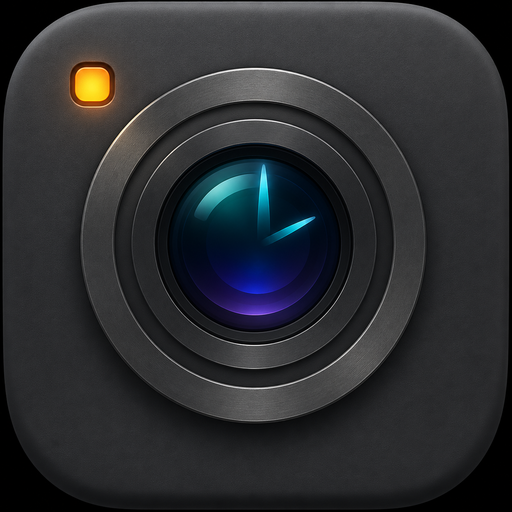

<p align="center"></p>

# Timecounter

An Android camera that saves photos and videos with time and location watermarks. Built with Java and CameraX, with a portrait interface and physical-orientation-aware output.

**Community beta · Android 8.0+ · English and Vietnamese UI**

**[Download Timecounter APK — Android 8.0+](https://github.com/TaiThanDen/Timecounter/releases/download/v1.0.0-beta.1/timecounter-1.0.0-beta.1.apk)**

[Release notes and checksums](https://github.com/TaiThanDen/Timecounter/releases/tag/v1.0.0-beta.1)

[Download APK](https://github.com/TaiThanDen/Timecounter/releases) · [Report a bug](https://github.com/TaiThanDen/Timecounter/issues) · [Privacy](PRIVACY.md) · [Changelog](CHANGELOG.md)

## Features

- JPEG photos and MP4 videos with watermarks burned into the saved media.
- A portrait-only interface; output orientation follows the way you hold the phone.
- Aspect ratios, output-size options, editable watermark templates and a custom clock.
- Flash, front/rear camera switching, pinch zoom, tap focus and exposure adjustment.
- Auxiliary wide-camera support where the device and camera provider expose it.
- System location and reverse geocoding, with an editable address label.
- A local gallery with sharing, photo zoom and video playback controls.

The launcher uses the owner's custom Timecounter icon. The reference-style watermark, fonts, template catalogue and camera behavior are intentionally preserved. **This project is an independent Timemark-style implementation, not an official Timemark product or service.**

## Install

1. Download `timecounter-*.apk` from [Releases](https://github.com/TaiThanDen/Timecounter/releases).
2. Open the APK and allow installation from your browser/file manager if Android asks.
3. Grant camera access. Location enables location labels; microphone access enables video audio.
4. Take a test photo and open the saved file to check its orientation and watermark.

Release downloads include a `SHA256SUMS` file for checking file integrity. Android will reject an update over a development APK signed with a different key. Export any app-private data before uninstalling a development build. Official updates must retain the same release signing key.

New photos are saved to `Pictures/TimemarkCamera` and videos to `DCIM/Camera`. The package ID is `com.pgkit.timemarkcamera` for compatibility with existing installations.

## What a watermark means

The default clock follows the device. Users can also select a custom date/time, pause that clock or edit the visible address. Location accuracy and address availability depend on the device and geocoder.

The photo's local code is randomly generated. The reference-style “Timemark Verified” label is reproduced visually; it **does not perform server verification, certify authenticity, or prove the time/location of capture**. Timecounter does not connect to Timemark's verification service. Check visible text and embedded metadata before sharing files.

## Beta limitations

- Camera availability, zoom range, output sizes and auxiliary lenses vary by hardware.
- Watermark dates and some template labels remain Vietnamese.
- Automated tests and limited LG device checks have passed. Full preview, JPEG and video validation in all four physical orientations remains pending for this beta.
- An emulator cannot substitute for physical orientation testing.

## Privacy

No account, advertising SDK, analytics service or app-operated upload server is included. Captures are stored locally. Android's location/geocoding services may use their own network providers. Saved files may include visible location information and GPS/camera metadata. See [PRIVACY.md](PRIVACY.md).

## Build from source

Requirements: JDK 17–21, Android SDK Platform 35, and an SDK path configured through Android Studio, `ANDROID_HOME`, or `local.properties` (`sdk.dir=...`).

```bash
./gradlew clean assembleDebug testDebugUnitTest
```

On Windows, use `gradlew.bat` with the same tasks. The debug APK is generated at `app/build/outputs/apk/debug/app-debug.apk`.

See [docs/RELEASING.md](docs/RELEASING.md) for release signing. No signing keys or passwords belong in Git.

## Code map

| Component | Responsibility |
| --- | --- |
| `MainActivity` | Permissions, lifecycle and coordination |
| `CameraScreen` | Portrait camera UI and user actions |
| `CameraEngine` | CameraX preview/capture, video, pixel rotation and saving |
| `DeviceOrientation` | Physical-orientation mapping |
| `WatermarkRenderer` / `VideoWatermarkRenderer` | Live and saved-media annotations |
| `LocationController` | Location fixes and system geocoding |
| `MediaLibrary` / `MediaViewerActivity` | Local browsing, viewing and playback |

[CONTRIBUTING.md](CONTRIBUTING.md) describes development checks. Sanitized research notes live under [docs/timemark_reference](docs/timemark_reference); raw device dumps and private capture evidence are excluded from the shared repository. Historical research claims are not proof that every feature works on every phone.

## License and attribution

[MIT](LICENSE) applies to the project's original source code. Fonts, reference-derived assets and third-party libraries are excluded from that grant and retain their own terms. **This is not a claim that all bundled reference assets have been cleared for unrestricted redistribution.** The custom app artwork is reserved for project identification. See [THIRD_PARTY_NOTICES.md](THIRD_PARTY_NOTICES.md) for the exact scope and known provenance limits.
